# Mermaid diagram types: syntax and examples

Each example is complete and valid. Copy the shape, then change the labels. Do not add a `theme` line for chat output.

## flowchart

`LR` left to right, `TD` top down. Shapes: `[box]`, `(rounded)`, `{decision}`, `[(database)]`, `((circle))`. Edge labels: `-->|text|`.

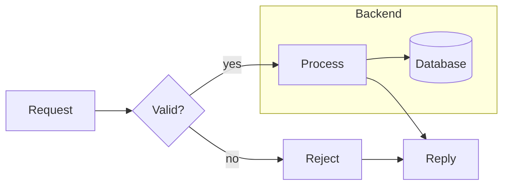

## sequenceDiagram

`->>` request, `-->>` reply, `+`/`-` activate and deactivate, `alt`/`else` for branches, `Note` for remarks.

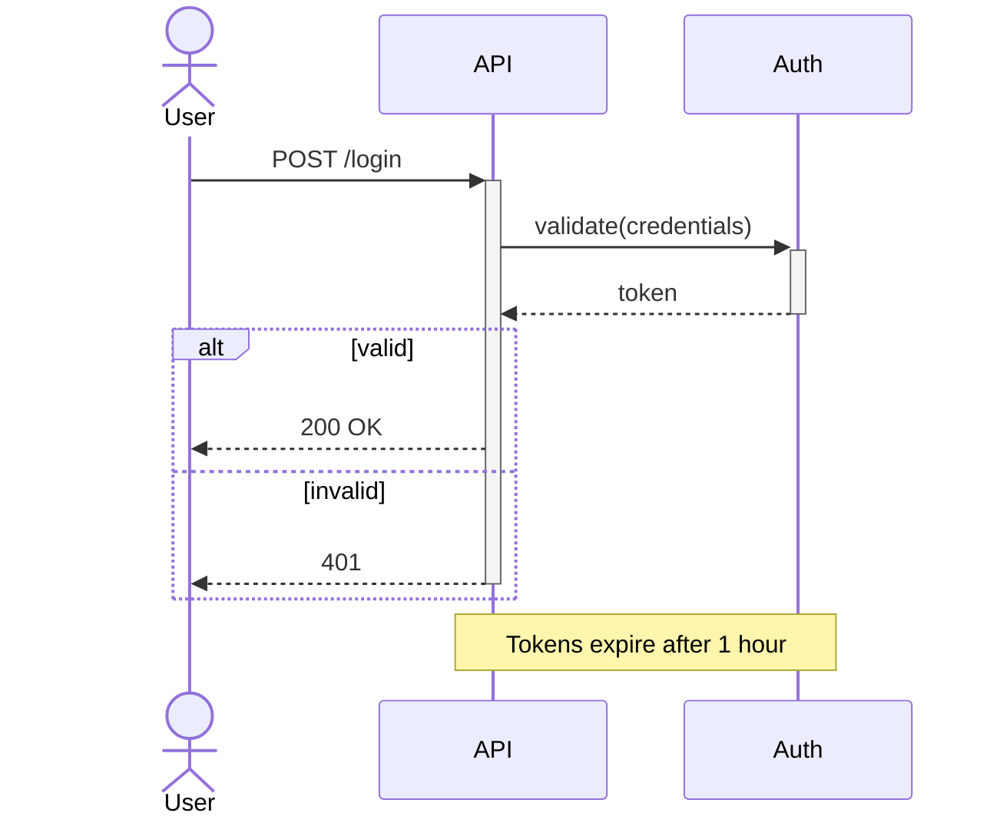

## classDiagram

Visibility `+` public, `-` private. Relations: `<|--` inheritance, `-->` association, `*--` composition, `o--` aggregation.

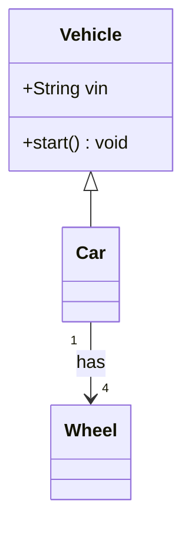

## erDiagram

Cardinality: `||` exactly one, `o|` zero or one, `|{` one or more, `o{` zero or more. Mark keys with `PK` and `FK`.

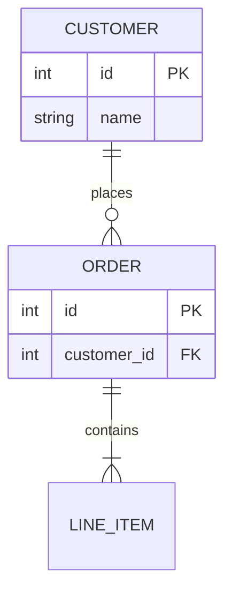

## stateDiagram-v2

`[*]` is the start and end state.

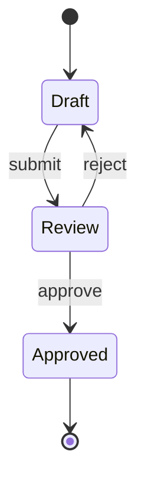

## gantt

Set `dateFormat`. Task syntax: `name :status, id, start, duration`. Statuses: `done`, `active`, `crit`. A start can be `after <id>`.

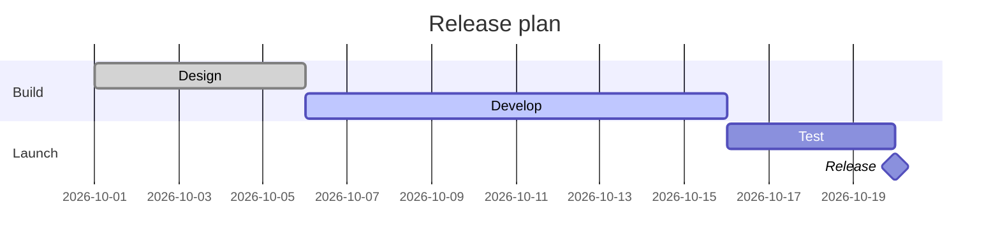

## timeline

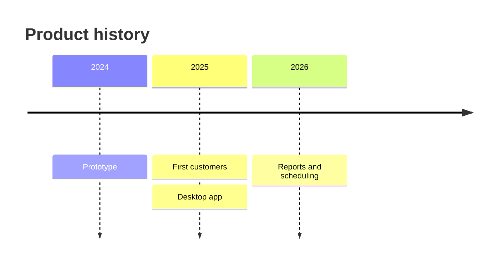

## mindmap

Hierarchy is set by indentation. The root can use `(( ))` for a circle.

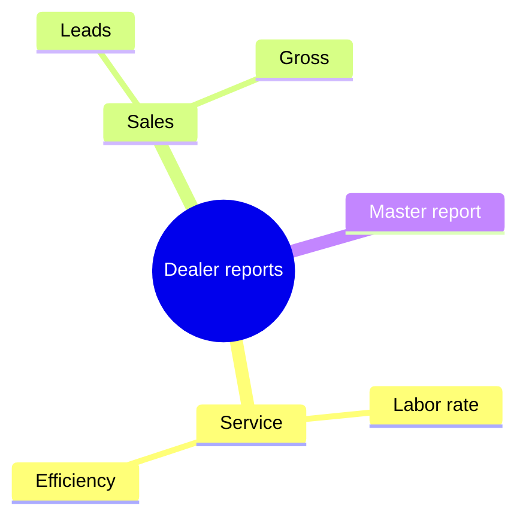

## pie

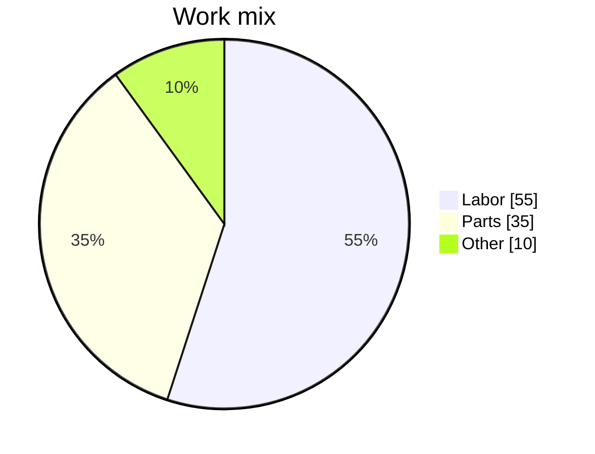

## gitGraph

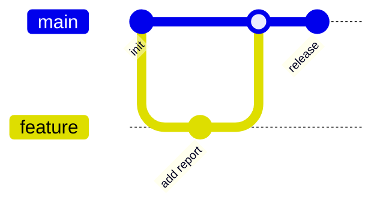

## C4Context (experimental)

Prefer a `flowchart` with subgraphs when exact look matters.

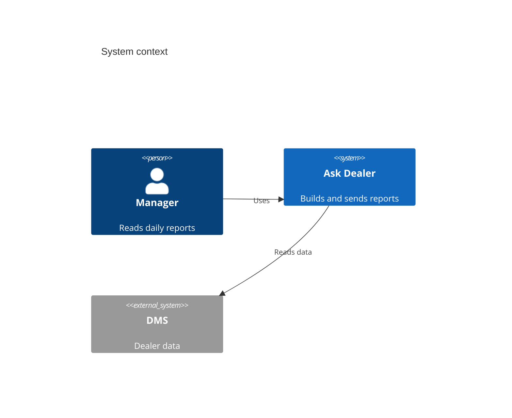
